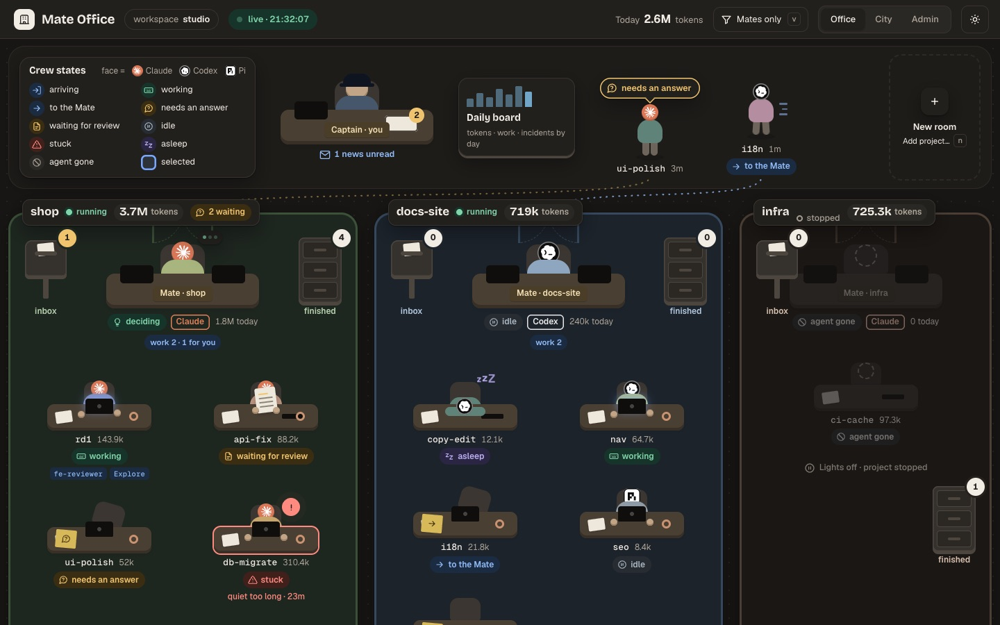
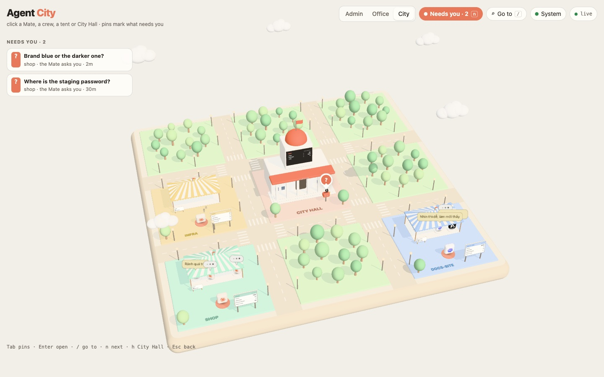
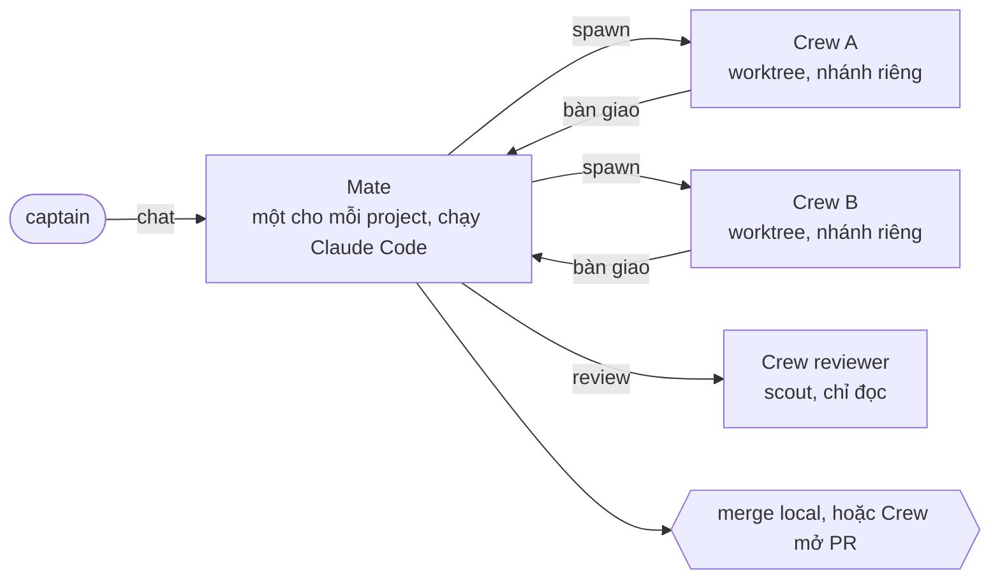
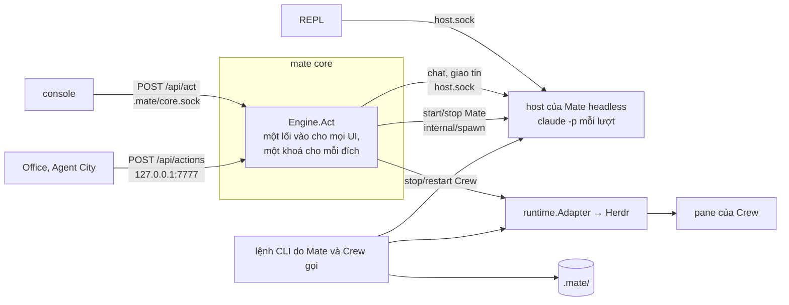

<p align="center">
  
</p>

<h1 align="center">mate</h1>

<p align="center">
  <b>Một đội agent lập trình trên máy của bạn: bạn nói với Mate, Mate điều phối Crew.</b>
</p>

<p align="center">
  
  
  
</p>

<p align="center">
  <a href="https://mate.lovableai.space">Website</a> ·
  <a href="docs/architecture.md">Kiến trúc</a> ·
  <a href="GLOSSARY.md">Thuật ngữ</a>
</p>

<table>
  <tr>
    <td width="50%"></td>
    <td width="50%"></td>
  </tr>
  <tr>
    <td align="center"><b>Mate Office</b>: mỗi project một phòng</td>
    <td align="center"><b>Agent City</b>: workspace dựng thành một thành phố</td>
  </tr>
</table>

Bạn là **captain**. Mỗi project có một **Mate**: bạn nói việc với Mate, Mate chia
việc và giao cho các **Crew** chạy song song, mỗi Crew một git worktree riêng. Mate
cho review độc lập, rồi merge, hoặc để Crew mở PR. mate là một binary Go: core của
workspace, console trong terminal, dashboard web và CLI cho agent gọi.



**Mục lục:** [Vì sao mate](#vì-sao-mate) · [Nền tảng hỗ trợ](#nền-tảng-hỗ-trợ) ·
[Cần cài trước](#cần-cài-trước) · [Cài mate](#cài-mate) · [Chạy](#chạy) ·
[Kiến trúc](#kiến-trúc) · [Phát triển](#phát-triển)

## Vì sao mate

- 🧭 **Mỗi project một Mate.** Bạn nói việc một lần; Mate viết brief, chia việc,
  theo dõi Crew và chỉ hỏi bạn khi cần bạn quyết.
- 🌿 **Crew chạy song song.** Mỗi Crew một git worktree và một nhánh riêng, không
  giẫm lên nhau.
- 🔍 **Review độc lập trước khi merge.** Một Crew khác, chỉ đọc, xét thay đổi so với
  brief.
- 🛟 **Core chạy nền.** Đóng console hay trình duyệt không mất việc; core giám sát
  host của Mate và bật lại khi host chết.
- 🏢 **Xem trực tiếp.** Mate Office và Agent City vẽ cả workspace trong trình duyệt,
  ai đang làm, ai đang chờ bạn.
- 🔌 **Đa harness cho Crew.** Crew chạy Codex, Claude Code, pi hoặc grok.

## Nền tảng hỗ trợ

| Nền tảng | Tình trạng |
| --- | --- |
| macOS Apple silicon | Chạy hằng ngày, đủ tính năng. |
| Linux x86_64 / arm64 | Build và test được (`make check-linux`). Chưa ai chạy thật hằng ngày. |
| Windows qua WSL2 | Cài mọi thứ trong WSL2 như trên Linux; workspace dưới `~`, không dưới `/mnt/c`; mở Office ở `http://localhost:7777` từ trình duyệt Windows. Chưa kiểm chứng ([docs/install.md](docs/install.md)). |
| Windows native | Không có. Code dùng syscall chỉ có trên Unix. |

## Cần cài trước

| Thứ | Để làm gì | Bắt buộc |
| --- | --- | --- |
| Go 1.25+ | Cài hoặc build mate | Có |
| git | Repo, worktree, merge | Có |
| [Herdr](https://herdr.dev) | Chạy Crew trong pane (agent multiplexer, giống tmux) | Có |
| `claude` (Claude Code), đã đăng nhập | Mate chỉ chạy trên Claude Code | Có |
| `codex`, đã đăng nhập | Harness mặc định cho Crew | Có, trừ khi đổi `crew_harness` |
| `pi`, `grok`, đã đăng nhập | Harness khác cho Crew | Không |
| `gh`, đã `gh auth login` | Crew giao bằng PR | Khi dùng PR |
| [WezTerm](https://wezterm.org), hoặc [Ghostty](https://ghostty.org) 1.3+ trên macOS | Console mở pane của agent bên cạnh | Nên có |

Mỗi harness tự đăng nhập bằng tài khoản của nó; mate không chép token giữa các
harness. Không có `codex` thì đặt `defaults.crew_harness: claude` trong
`.mate/workspace.yaml`. Trên macOS:

```sh
brew install go git gh herdr
```

## Cài mate

```sh
go install github.com/nguyenngocanh94/mate/cmd/mate@latest
```

Module path còn mang tên chủ cũ của repo; GitHub tự chuyển sang
`github.com/ericsnguyen9941/mate`, nên lệnh trên chạy đúng như đã viết. `go install`
đặt `mate` vào `$GOBIN`, hoặc `$(go env GOPATH)/bin` (mặc định `~/go/bin`); thư mục
đó phải nằm trong `PATH`. Hoặc build từ mã nguồn:

```sh
git clone https://github.com/ericsnguyen9941/mate.git
cd mate
make build      # ra bin/mate; chép nó vào một thư mục trong PATH
```

**Cập nhật:** chạy lại `go install …@latest`, hoặc `git pull && make build` rồi chép
`bin/mate` đè lên bản cũ (trên macOS: `rm` file cũ rồi `cp`). Core đang chạy vẫn dùng
binary cũ, và `mate` không tự thay nó: `mate` in `mate core: already running` kèm dòng
`stale: the mate binary changed after this core started`. Tắt core cũ (Ctrl+C ở
terminal đang chạy nó) rồi chạy lại `mate`; `mate console` thì tự hỏi có bật lại core
bằng binary mới không. Chi tiết: [docs/install.md](docs/install.md).

## Chạy

```sh
mate init ~/workspace   # một lần: tạo workspace
cd ~/workspace
mate                    # hoặc: mate . / mate ~/workspace
mate console            # trong terminal khác, nếu muốn
```

`mate` chạy core của workspace ở foreground, như một dev server: in link Office và
City (mặc định `http://127.0.0.1:7777/office/` và `/city/`) rồi log của core; Ctrl+C
để dừng. Core đang chạy rồi thì `mate` in trạng thái của nó và thoát. `mate console`
mở giao diện terminal; chưa có core thì nó tự bật core chạy nền. `mate` không tự tạo
workspace: không thấy `.mate/` ở thư mục hiện tại hay thư mục cha thì nó in danh
sách lệnh và thoát; `mate <dir>` với thư mục chưa có `.mate/` báo `not a mate workspace`.

Hướng dẫn dùng nằm trong `docs/`: chạy core [docs/core.md](docs/core.md), console
và phím [docs/console-commands.md](docs/console-commands.md), tracker
[docs/task-management.md](docs/task-management.md), plugin
[docs/plugins.md](docs/plugins.md), review [docs/review.md](docs/review.md),
notification [docs/notifications.md](docs/notifications.md).

## Kiến trúc

Bản đồ đầy đủ: [docs/architecture.md](docs/architecture.md). Cách chạy core:
[docs/core.md](docs/core.md). Thuật ngữ: [GLOSSARY.md](GLOSSARY.md).

### Process

| Process | Việc |
| --- | --- |
| mate core | Engine của workspace: observer và timeline, outbox, auto daemon, recovery, giám sát host của Mate, Office/City, notification. Chạy foreground khi captain chạy `mate`, hoặc chạy nền khi console bật nó. Mỗi workspace một core: nó giữ flock trên `.mate/core.lock` và phục vụ client trên `.mate/core.sock`. |
| Host của Mate headless | Process nền riêng, ngoài Herdr, mỗi Mate một host; bật khi Mate start. Mỗi tin là một lượt `claude -p`. Nghe trên `host.sock`. Core giám sát và bật lại khi host chết, tối đa 3 lần trong 10 phút; dừng core không dừng host. |
| Console | Giao diện terminal, client của core qua `core.sock`, không chạy engine. Mỗi workspace một console (`console.lock`). |
| REPL của Mate | Khung chat với Mate headless, console hiện nó ở pane bên cạnh. Client của `host.sock`. |
| Office, Agent City | Trang web core phục vụ ở `127.0.0.1:7777` (`/office/`, `/city/`). |
| TUI của Mate | Session của Mate headless mở tạm trong TUI của Claude, từ pane shell của Mate. Giữ `.mate/tui.lock`; trong lúc đó mọi UI chỉ xem. |
| Crew | TUI của harness trong pane Herdr, làm việc trong `<workspace>/.worktrees/<p>-<crew>`. Mate spawn nó bằng lệnh CLI. Ghi dòng trạng thái vào file `.status`. |
| PR watcher | Một process cho mỗi PR của Crew, do lệnh CLI hoặc recovery và auto daemon của core bật. PR merge hay đóng thì báo Mate qua outbox. |
| Lệnh CLI | Lệnh ngắn do Mate và Crew gọi. Không qua core: đọc và ghi thẳng `.mate/`, gọi Herdr hay `host.sock` khi cần. |

Console, REPL, Office và City chỉ là vỏ: engine chạy trong core, Mate chạy trong host.
Đóng console không dừng core.

### Đường đi của một hành động



Core không spawn Crew: Mate gọi một lệnh CLI, lệnh này tự mở pane trong Herdr.
Bên cạnh `Engine.Act`, core chạy các vòng lặp: observer, timeline, outbox, auto,
recovery và giám sát host.

Các process trao đổi chủ yếu qua file trong `.mate/`; các file nhiều bên cùng sửa
(outbox, news, work, backlog) khoá bằng `flock`. `mate.db` (SQLite) chỉ có một bên
ghi và dựng lại được từ file. Socket unix (`core.sock`, `host.sock`) cho lệnh cần trả
lời ngay.

<details>
<summary><b>Tầng package</b></summary>

Bảy tầng, thấp lên cao. Một package chỉ import package cùng tầng hoặc tầng thấp hơn.

| Tầng | Ví dụ |
| --- | --- |
| 1 leaf | `brief`, `config`, `platform`, `process` |
| 2 storage | `store`, `db`, `plugin` |
| 3 read | `query`, `coreapi`, `harness`, `runtime` |
| 4 integration | `harness/claude`, `runtime/herdr`, `matehost`, `coreclient`, `notifications` |
| 5 service | `spawn`, `outbox`, `watch`, `recovery`, `dashboard`, `core` |
| 6 UI | `ui/console` (Office và City là trang web trong `internal/dashboard/ui/`) |
| 7 binary | `cmd/mate` |

`internal/archtest/layers_test.go` giữ luật này trong `make check`: package chưa có
tầng, hay import sai tầng, làm build đỏ. Vi phạm còn lại ghi trong
`internal/archtest/violations.txt`, và phần nợ ở đó chỉ được giảm. Các test ranh
giới khác giữ luật riêng: ngoài `internal/harness/...` không code nào gọi tên một
harness, trừ vài file có lý do trong `ratchetAllow`; `ui/console` không import
`store`, `core` hay Herdr; chỉ `internal/spawn` import `runtime/herdr`.

</details>

<details>
<summary><b>Thư mục <code>.mate/</code></b></summary>

```
<workspace>/.mate/
├── workspace.yaml          danh sách project, harness mặc định, lane
├── .env, console.yaml      cấu hình của captain (biến, phím tự gắn, dashboard)
├── plugins.yaml            plugin của mọi Mate
├── WORKSPACE.md, CREW.md   luật cho Mate, cho Crew
├── core.lock, core.sock    core đang chạy (flock), socket cho client
├── core.log                log của core
├── console.lock, tui.lock  một console, một TUI của Mate mỗi workspace
├── mate.db                 timeline SQLite, dựng lại được từ file
└── projects/<p>/
    ├── project.yaml, PROJECT.md
    ├── sent.log, incidents.log
    ├── crews/<crew>.meta, <crew>.status, <crew>/brief.md, report.md, handback.md
    └── mate/               mate.meta, .outbox, news.jsonl, work.jsonl,
                            host.sock, host.log, memory.md, tui
```

Worktree của Crew nằm ở `<workspace>/.worktrees/<p>-<crew>`, ngoài `.mate/`.

</details>

<details>
<summary><b>Harness và Herdr</b></summary>

Mate chỉ chạy Claude Code: chỉ harness có lượt headless mới chạy được Mate. Crew
chạy `codex` (mặc định), `claude`, `pi` hoặc `grok`. Mỗi harness là một package trong
`internal/harness/<tên>`, đăng ký ở `internal/harness/catalog`.

Herdr chỉ là lớp pane, như tmux: nó chạy TUI của Crew (và của Mate ở `mate.mode:
pane`) cùng pane shell của Mate. Host của Mate headless chạy ngoài Herdr. mate gọi
Herdr qua `runtime.Adapter`. Mỗi workspace một session Herdr; tên của nó là dòng
`Herdr` core in ra.

</details>

## Phát triển

```sh
make build              # bin/mate
make check              # gofmt, go vet, go test qua scripts/gotestreport
make test-race          # test với -race
MATE_LIVE=1 make test   # thêm test TestLive* chạy Herdr và harness thật
```

Test bị skip mà không khai trong `scripts/gotestreport/expected-skips.txt` làm build
đỏ. Suite xanh khi test live bị skip không chứng minh tính năng chạy với Herdr thật.
Quy ước cho agent làm việc trên repo này: [AGENTS.md](AGENTS.md).

<sub>Ảnh Office và City chụp từ giao diện thật trong repo, với dữ liệu mẫu của test
(`internal/dashboard/testdata/office/busy.json`).</sub>
