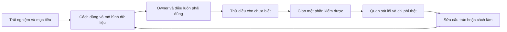

# Triết lý xây dựng và tư duy thiết kế của pstack

Khảo sát ngày 2026-10-29, source pstack 0.15.36 tại commit [`1ba91fc25c0977741dd0e267849e6234b037ed0a`](https://github.com/cursor/plugins/tree/1ba91fc25c0977741dd0e267849e6234b037ed0a/pstack). Đã đọc 24 principle leaf, architect cùng references, how/why, reflect/correct và guide 04/08/09. Đây là diễn giải source; chưa có thử nghiệm chứng minh hiệu quả trên mate.

## Luận điểm trung tâm

**Diễn giải của nghiên cứu:** pstack muốn chuyển gánh nặng từ “agent phải nhớ hết và suy nghĩ đúng” sang “môi trường làm việc khiến lựa chọn đúng trở nên tự nhiên, lựa chọn sai khó thực hiện và kết quả có thể kiểm lại”. Prompt giữ phần phán đoán còn lại; cấu trúc code, quyền sở hữu, công cụ và bằng chứng giữ phần có thể cơ giới hoá.

Luận điểm này dựa trực tiếp vào `/correct`: giả định contributor chỉ thấy các file đã mở, sao chép ví dụ gần nhất và chọn đường ngắn nhất còn compile; repo phải làm cho thay đổi có vẻ đúng từ một file cũng đúng trong toàn hệ thống. Architect cụ thể hoá bằng một owner/state, một cách làm/task, internals không import được, danh sách dẫn xuất từ một nguồn. [Correct][correct], [design red flags][flags].

Đây không phải luận điểm “agent thông minh hơn sẽ sửa được mọi vấn đề”. Nó coi **sự hiểu biết cục bộ** là điều kiện thiết kế phải chấp nhận. Cũng không đồng nghĩa code càng ngắn càng tốt: source ưu tiên trải nghiệm người dùng, interface dễ dùng và công việc người bảo trì phải mang trong đầu. [Experience First][experience], [Minimize Reader Load][reader].

Tám mục dưới đây là cách tổng hợp của nghiên cứu, không phải tám tiêu đề do upstream công bố. Các ví dụ là minh hoạ do nghiên cứu đặt ra, không phải số liệu hay case study của pstack.

## Pstack tự xây bộ phương pháp của nó như thế nào

Nhìn từ source, có bốn lớp trách nhiệm; đây là cách phân loại của nghiên cứu:

| Lớp | Việc nó giữ | Ví dụ |
| --- | --- | --- |
| Principle leaf | Lý do, trigger và từ vựng chung để đổi một quyết định | `Model the Domain`, `Prove It Works`. |
| Skill | Phương pháp lặp lại cho một loại câu hỏi hoặc artifact | `how`, `architect`, `interrogate`. |
| Mode/playbook | Chọn phương pháp và thứ tự theo loại task | `poteto-mode` chọn bug-fix, feature, multi-phase-plan. |
| Script/check | Thao tác deterministic hoặc phép kiểm có thể chạy lại | check-plan, worktree audit, decision-log helper. |

Principle name là tay lái ngắn cho người dùng, nhưng source yêu cầu agent chỉ ra quyết định cụ thể đã đổi; nêu tên nguyên tắc không tự chứng minh đã áp dụng. Skill được compose bằng tham chiếu thay vì chép lại protocol. `show-me-your-work` chẳng hạn tự sở hữu format trail và yêu cầu nơi khác gọi tên nó. [Guide nguyên tắc][principles-guide], [Show Me Your Work][trail].

Guide khuyên bắt đầu nhỏ, xem failure thật rồi thêm skill/check khi failure lặp; không cần cả plugin. Nó cũng đặt prototype và caller README trước detailed plan. Pstack không có planning skill riêng nhưng có multi-phase-plan playbook: ý là tránh lập kế hoạch dài trên giả định chưa thử, không phải cấm lập kế hoạch. [Guide tuỳ biến][custom-guide], [Guide thiết kế][design-guide].

## 1. Bắt đầu từ người dùng và ràng buộc thật

**Source nói:** viết usage như README cùng hai hoặc ba call site trước, rồi suy ra types/signatures; nếu hai bên lệch thì sửa sketch theo usage. Người dùng gồm cả người gọi thư viện và người bảo trì. Nền tảng phục vụ trải nghiệm, không được biến thành mục tiêu riêng. [Rationale template][rationale], [Experience First][experience].

`how` xây mô hình cách hệ thống đang chạy. `why` tìm lực đã tạo ra thiết kế: quyết định lịch sử, nhu cầu sản phẩm, incident, hạn chế hạ tầng. Nó phân biệt điều tác giả nói trực tiếp, kết luận có hỗ trợ, suy luận, phỏng đoán và chưa biết. Không lấy “code hiện tại hợp lý” làm bằng chứng cho ý định người viết. [How][how], [Why][why], [epistemics][epistemics].

**Cơ chế:** bắt đầu từ caller buộc thiết kế trả lời “người dùng cần biết gì để làm xong việc”; đọc lịch sử tránh xoá nhầm ràng buộc đã bị che bởi code cũ. Với câu hỏi quan sát được, prototype tạo dữ liệu thay cho tranh luận. [Guide thiết kế][design-guide].

**Ví dụ:** trước khi thêm ba callback vào một module import, viết cách caller nhập một file, huỷ, và đọc lỗi. Nếu caller phải tự ghép parse/validate/retry/save, module có thể đang đẩy trách nhiệm của mình ra ngoài.

**Giới hạn:** prototype trả lời hành vi, độ trễ, bố cục; nó không tự quyết giá trị sản phẩm. Không cần khám phá nhiều hướng cho một sửa đổi hiển nhiên. Guide có thang mức đầu tư theo độ khó, dù một số trigger cụ thể của skill mạnh hơn mức cần dùng ở mọi repo.

## 2. Dùng mô hình dữ liệu để giảm số điều phải nhớ

**Source nói:** chọn core data shape trước logic, theo access pattern thật; gom module quanh tri thức và ownership thay vì thứ tự load/validate/transform/save. State machine, typed model, table/registry, reducer hoặc graph chỉ có giá trị nếu xoá branch, duplicated rule, invalid state hay lifecycle risk. [Foundational Thinking][foundation], [Model the Domain][domain].

Types phân biệt các primitive khác nghĩa, parse dữ liệu ngoài vào domain type, derive từ schema có chủ sở hữu. Một invariant có một nguồn; không bắt nhiều file cùng nhớ cập nhật một danh sách. [Type System Discipline][types], [design red flags][flags].

**Cơ chế:** mỗi bản sao quy tắc là một nơi agent có thể không nhìn thấy. Chuyển quy tắc vào biểu diễn giúp một chỉnh sửa cục bộ ít phải phối hợp với kiến thức nằm ngoài context. Điều này giảm số trạng thái sai có thể tạo ra, thay vì thêm xử lý sau khi đã tạo sai.

**Ví dụ:** `running`, `finished`, `failed` là ba boolean cho phép tổ hợp vô nghĩa. Một trạng thái có kiểu và transition do một owner kiểm soát khiến caller không phải tự đồng bộ ba cờ.

**Giới hạn:** “make illegal states unrepresentable” là mục tiêu thiết kế, không phải đảm bảo mọi ngôn ngữ đạt được. Parse đúng không chứng minh dữ liệu còn mới sau concurrency hay external mutation. Với Go, file/IPC, plugin hoặc foreign code, vẫn phải xác định điểm tái nhập dữ liệu và kiểm điều kiện runtime tương ứng. Đây là diễn giải áp dụng, không phải ngoại lệ upstream viết đầy đủ.

## 3. Module sâu giúp người đọc hiểu ít hơn mà làm được nhiều hơn

**Source nói:** module sâu có interface nhỏ che được nhiều quyết định và hành vi. Đừng nhầm với call chain sâu. Các dấu hiệu xấu là caller phối hợp nhiều method để hoàn thành một operation, public options lộ pha nội bộ, hoặc phải hiểu implementation mới dùng được interface. [Design red flags][flags], [runner prompt][runner].

Reader load có hai trục độc lập: số lớp phải lần theo và lượng mutable/hidden state phải giữ trong đầu. File phẳng với nhiều global vẫn khó hiểu; nhiều wrapper cùng hình dạng cũng vậy. Một lớp đáng tồn tại khi đổi abstraction hoặc giấu policy/complexity thật. [Minimize Reader Load][reader].

**Cơ chế:** giấu quyết định cùng chủ sở hữu tạo một nơi để học, sửa và kiểm. Tác vụ tương lai cần ít context hơn, và thay đổi quyết định không lan thành các thao tác phối hợp khắp caller. Source gọi việc lộ transport/schema/framework types là information leakage. [Boundary Discipline][boundary].

**Ví dụ:** `refreshIndex()` tự đảm nhiệm snapshot, rebuild và atomic publish có thể sâu hơn interface yêu cầu caller gọi `load()`, `lock()`, `reset()`, `scan()`, `save()`, `unlock()` đúng thứ tự.

**Giới hạn:** không đánh giá depth bằng số dòng implementation. Không gom mọi thứ vào một “manager” chỉ để ít method. Pass-through có thể hợp lý nếu thật sự đổi representation, áp policy hoặc tạo seam cần thiết; source cho phép các trường hợp này. Các heuristic “30 giây”, “ba file” là tín hiệu khảo sát, không phải SLO để lint máy móc.

## 4. Nghĩ lại toàn bộ hình dạng, giao phần nhỏ nhất có thể kiểm

**Source nói:** khi có yêu cầu mới, hình dung thiết kế nếu biết yêu cầu ấy ngay từ đầu; hiểu phần bị ảnh hưởng rồi giao tăng dần. Đồng thời, xoá phần thừa trước, consolidate quyết định và giữ diff nhỏ nhất giải quyết được vấn đề. [Redesign from First Principles][redesign], [Subtract Before You Add][subtract], [Laziness Protocol][lazy].

**Cơ chế:** câu hỏi greenfield dùng để thoát khỏi hình dạng tình cờ của code cũ; nó không tự cấp lý do rewrite. Subtraction giảm số ràng buộc giả phải kéo theo. Alternative sketch/prototype giúp tách lựa chọn thật với quán tính của đáp án đầu tiên. [Architect][architect], [Exhaust the Design Space][exhaust].

**Ví dụ:** một tính năng mới khiến ba wrapper cần thêm cùng một flag. Trước khi thêm flag ở cả ba, xem có một quyết định chung đặt được vào owner không. Kết quả hợp lý có thể là xoá một wrapper, không phải xây framework mới.

**Giới hạn:** “migrate rồi xoá API cũ” được source giới hạn ở API nội bộ, không có external user cần compatibility và có thể phối hợp breaking change. Planned migration có thể chấp nhận trạng thái trung gian hỏng chỉ khi có scope, khả năng đảo ngược và verification boundary rõ. [Migrate Callers][migrate], [Outcome-Oriented Execution][outcome].

Không xoá guard/retry chỉ vì trông phòng thủ. `Fix Root Causes` phân biệt state hợp lệ nhưng chưa được xử lý với state lẽ ra không tồn tại: ở trường hợp đầu, guard đúng chỗ chính là sửa gốc. [Fix Root Causes][root-causes].

## 5. Coi phát biểu kỹ thuật là giả thuyết phải phân biệt được đúng sai

**Source nói:** xác minh artifact thật thay vì proxy, báo cáo của agent hay “compile được”; test phải fail khi hành vi sai và vẫn pass khi chỉ đổi implementation. Hai fix cùng giả định mà đều fail là tín hiệu kiểm lại giả định trước fix thứ ba. [Prove It Works][proof], [Test Behavior][behavior], [Attack the Premise][premise].

**Cơ chế:** thay vì hỏi “có câu chuyện nào giải thích được kết quả?”, hỏi “quan sát nào sẽ khác nếu câu chuyện này sai?”. Điều đó ngăn chỉnh sửa tích luỹ quanh một tiền đề chưa kiểm, test tự khẳng định dữ liệu mình tạo, và báo cáo đúng theo ý định thay vì artifact.

**Ví dụ:** một test xác nhận object `message` đã được tạo không chứng minh receiver nhận một lần. Phép kiểm cần quan sát receiver ở trường hợp bình thường và retry; tạo chủ đích biến thể gửi hai lần để biết phép kiểm nhìn thấy lỗi.

Trước benchmark/eval, source yêu cầu ghi kết quả nào sẽ đổi quyết định và noise floor. Sau đó xác định bottleneck bằng profile/counter; loại cached/skipped work, lỗi, lệch cấu hình và hiệu ứng không đáng kể end-to-end. Giữ run count và spread bên con số. [Explain the Number][number].

Thứ tự giao hàng cũng là một phần lập luận: baseline trước treatment, failing test trước fix, subtraction trước reshape. Mỗi unit kết thúc ở điểm có thể kiểm giúp định vị lỗi ngay nơi tạo ra nó. [Sequence Verifiable Units][sequence].

**Giới hạn:** test/repro có phạm vi, không chứng minh vắng mọi bug. Không tìm được lỗi đã chạy được không bằng acceptance hoàn thành. Đặc biệt quy tắc upstream `interrogate` loại finding chưa chạy có thể bỏ sót rủi ro static quan trọng; adaptation nên giữ chúng thành unverified/gap, không biến thành pass. Đây là phê bình và đề xuất của nghiên cứu. [Interrogate][interrogate].

## 6. Tạo công cụ kiểm lại được, rồi đưa lỗi lặp vào cấu trúc

**Source nói:** `Build the Lever` tạo codemod/script/generator hoặc recipe chung để làm hoặc chứng minh việc trước mắt. Làm một unit để học, chạy tool lại đối chiếu, và làm nó an toàn để rerun. Script deterministic thắng fan-out khi có thể xử lý mọi unit theo cùng một cách. [Build the Lever][lever].

`Encode Lessons in Structure` có mục tiêu khác: lỗi hoặc lời nhắc lặp lại cần thành guardrail bền. `/correct` xếp thứ tự architecture → types/lint/CI → behavioral test → prose dành cho judgment. Check mới phải fail trên một lỗi thật trong quá khứ; lỗi đã bất khả thi thì bỏ rule nhắc lại. [Encode Lessons][encode], [Correct][correct].

**Cơ chế:** một lời nhắc tiêu tốn chú ý ở mọi lần dùng và vẫn có thể bị quên. Một biểu diễn đúng hoặc check đúng chặn lỗi ở nơi nó xuất hiện; error có thể chỉ đường sửa. Tool cũng làm review không phụ thuộc trí nhớ và uy tín của người vừa thực hiện.

**Ví dụ:** agent hai lần thêm một loại job vào enum nhưng quên bảng hiển thị. Giải pháp tốt hơn thêm bullet “nhớ cập nhật bảng” là derive bảng từ một nguồn, hoặc build fail chỉ đúng mục thiếu.

**Giới hạn:** không phát minh framework để thay hai edit hiển nhiên. Không cố lint một quyết định ngữ cảnh chưa ổn định, vì false positive và ngoại lệ có thể làm hỏng workflow. Đọc một lỗi lặp hai lần là dấu hiệu điều tra, không phải thống kê chứng minh phổ biến. Rule cần judgment thì giữ hướng dẫn ngắn và ví dụ failure; source nói rõ ngoại lệ này.

## 7. Tự chủ dựa trên ownership và khả năng phục hồi

**Source nói:** trước khi thêm lock, hỏi các actor có thật sự phải ghi cùng một object không. Tách state theo owner nếu chúng chỉ công bố fact độc lập; nếu cần một object canonical, enforce single writer/lock/CAS bằng cấu trúc, không bằng lời dặn. [Separate Before Serializing][separate].

Mỗi operation phải trả lời chạy hai lần và crash giữa chừng sẽ ra sao; derive bước tiếp theo từ state thực tại, nhận ra partial/stale artifact và hội tụ về đích. [Make Operations Idempotent][idempotent].

**Cơ chế:** ownership làm conflict ít xảy ra hơn; idempotence làm retry không cần trí nhớ hoàn hảo về ý định lần trước. Coordinator có thể giao việc theo contract rồi kiểm artifact thay vì trực tiếp can thiệp mọi bước. Giới hạn context/phases/scope giữ mỗi người nhận phần có thể hiểu được. [Guard the Context Window][context], [Orchestrate][orchestrate].

**Ví dụ:** hai worker ghi hai file kết quả riêng rồi coordinator đọc để tổng hợp thường đơn giản hơn cùng sửa một JSON và thêm “đừng ghi trùng” vào prompt. Một canonical registry thật sự dùng chung vẫn cần serialization.

**Giới hạn:** “never block” trong leaf áp dụng cho việc reversible và dành product direction cho người dùng. Source có lệch policy: leaf xếp external messages vào nhóm cần xác nhận, còn `poteto-mode` cho team chat/ticket updates đi tiếp và chỉ chặn customer message. Vì vậy có thể học cơ chế ownership, nhưng quyền hành động phải do host/user định nghĩa thống nhất; không copy khẩu hiệu autonomy thành quyền. [Never Block][autonomy], [poteto-mode][mode].

## 8. Tích luỹ năng lực qua bằng chứng, không tích luỹ thêm lời dặn

**Source nói:** log decision/checkpoint, không log mọi thao tác; một canonical trail ghi lựa chọn, lý do, evidence pointer và kết quả. Khi sai, append correction; đối chiếu trail với transcript/artifact. Có trail giúp người trở lại sau một thời gian hiểu các ngã rẽ và việc đã bỏ. [Show Me Your Work][trail].

`reflect` dành cho bài học bền từ session và chỉnh skill có chủ đích; one-off không tự thành rule. Nó tách Accepted/Rejected/Backlog, ưu tiên structural fix hơn prose. Guide yêu cầu thử skill change bằng task tự nhiên, candidate không biết biến thể, rubric chung và đọc output thật; bắt đầu nhỏ, không cần toàn plugin. [Reflect][reflect], [Guide tuỳ biến][custom-guide].

**Cơ chế:** artifact giải thích vì sao chọn A thay B giữ tri thức qua người/agent mới. Nhưng muốn “học” thì thay đổi tương lai phải giúp một lớp quyết định, được kiểm lại và có thể bỏ nếu gây hại. Thêm rule sau mọi thất bại chỉ làm policy phình và overfit câu chuyện vừa xảy ra.

**Ví dụ:** thay vì kết luận “luôn chạy ba reviewer” sau một bug lọt, xác định bug lọt vì reviewer thiếu base SHA; sửa contract và kiểm trên một case lỗi cũ cùng case bình thường. Chỉ tăng reviewer nếu evidence cho thấy góc nhìn độc lập là yếu tố thiếu.

**Giới hạn:** record không phải truth nếu evidence không resolve hoặc không cùng artifact/head. Blind eval giảm một loại bias, không tự bảo đảm tính đại diện. Không auto-promote một lesson thành policy toàn tổ chức; upstream reflect đòi review cho skill edits. Điều này là mô tả source, không tạo thêm approval workflow cho nghiên cứu hiện tại.

## Những căng thẳng cần giữ khi áp dụng

| Hai lực trong pstack | Cách đọc có điều kiện |
| --- | --- |
| “Diff nhỏ” và “redesign từ đầu” | Nghĩ toàn hình dạng; chọn phần nhỏ nhất tiến tới đích, không mặc định rewrite. |
| Mỗi unit phải green và migration có thể hỏng tạm | Định nghĩa unit/gate trước; trạng thái hỏng phải nằm trong phạm vi phase được cho phép, không lan ra delivery. |
| Prototype nhiều hướng và tránh ceremony | Chỉ đa dạng hoá khi có bất định đáng tiền; không dùng số agent thay chất lượng câu hỏi. |
| Trust types và thực tại runtime | Trust contract trong phạm vi nó bảo đảm; re-enter boundary khi dữ liệu/tính hợp lệ có thể thay đổi. |
| Tự chủ và kiểm soát | Giảm phụ thuộc phê duyệt tác vụ reversible; ownership, scope và quyền host vẫn ràng buộc. |
| Bằng chứng chạy được và rủi ro chưa chạy được | Phân loại verified/unverified/incomplete; không đổi unknown thành safe. |
| Tích luỹ lesson và giảm prompt | Khi lesson đã được cấu trúc enforce, bỏ instruction trùng; eval rule mới thay vì giữ mãi. |

Các hàng là diễn giải giải quyết tradeoff, không khẳng định upstream tự giải quyết nhất quán tất cả. Hai ví dụ source cụ thể: `why` default điều tra đủ các nhóm nguồn dù một câu hỏi có thể hẹp, còn guide khuyên bắt đầu nhỏ; `architect` mặc định nhiều candidate khi crossing function, dù lợi ích phụ thuộc chi phí quyết định. Chủ dự án phải chọn mức đầu tư theo failure thực, không nhận toàn bộ mặc định làm quy luật phổ quát. [Why][why], [Architect][architect], [Guide tuỳ biến][custom-guide].

## Áp dụng vào mate: giữ nền tảng tốt và chọn nơi cần tiến thêm

Đối chiếu với working tree mate ở HEAD `d5e2b041992545e7ce9155c1f945cf584a81e9fc`, có thay đổi chưa commit từ trước. Đây là đọc spec/source, không phải kiểm chứng runtime mới. Kế hoạch tích hợp kỹ thuật ở [nghiên cứu trước](pstack-integration-2026-10-29.md); phần này tập trung vào cách thiết kế.

**Mate đã có nhiều quyết định cùng hướng với pstack.** Không cần đổi kiến trúc để mang nhãn pstack:

| Triết lý | Cơ chế hiện có trong mate | Điều nên giữ |
| --- | --- | --- |
| Mô hình phản ánh ý nghĩa thật | Spec tách lifecycle Crew khỏi health của pane; `wait-mate` là bàn giao, không phải đã hoàn tất. | Màn hình idle không được suy thành task done. Các thông tin khác nghĩa phải được biểu diễn riêng. |
| Một owner giữ quyết định khó | `internal/send` tập trung classify composer, type một lần, retry Enter có điều kiện và từ chối trạng thái không rõ; interface runtime của nó không có start/stop. | Caller dùng hợp đồng gửi, không tự triển khai lại chuỗi phím hoặc được cấp toàn bộ quyền runtime. |
| Một nguồn, kiểm sự nhất quán bằng máy | Catalog liệt kê harness; contract suite kiểm capability; ratchet lấy tên từ registry và chặn kiến thức riêng harness lan ra core ngoài allowlist. | Khi thêm harness, lỗi thiếu khai báo hiện thành lỗi kiểm tra, thay vì nhắc sửa một danh sách file thủ công. |
| Bằng chứng có phạm vi | Capability phân biệt `verified`, `unsupported`, `unknown`; verified cần version/ngày/proof. | Chưa đo không được coi là không hỗ trợ hoặc hỗ trợ. Metadata bằng chứng không thay cho việc đo lại khi môi trường đổi. |
| Tính đúng được giữ tại nơi thay đổi | `checkReview` đối chiếu fingerprint hiện tại và record; khác head/base/brief/handback thì review stale. | Không bắt agent nhớ bằng lời rằng verdict cũ hết hiệu lực. Fingerprint không tự chứng minh test đã bao phủ đúng hành vi. |
| Giữ ý định người dùng bằng cấu trúc | `ReviseTask` kiểm lời captain không bị thay đổi khi sửa task; revise và append có ý nghĩa riêng. | Dùng operation nêu đúng mục đích, giữ provenance; semantic consistency vẫn cần người/agent xét. |

Nguồn: [spec, mục 1–4b](../mvp.md), [send](../../internal/send/send.go), [pending recovery](../../internal/send/pending.go), [catalog](../../internal/harness/catalog/catalog.go), [capability](../../internal/capability/capability.go), [harness ratchet](../../internal/harness/ratchet_test.go), [review](../../cmd/mate/review.go), [brief revision](../../internal/brief/revise.go).

**Ba hướng đáng áp dụng tiếp, theo thứ tự đề xuất:**

1. **Biến lỗi lặp đã có bằng chứng thành cải tiến tại owner.** Dùng nguồn learning hiện tại để chọn một lớp lỗi, chẳng hạn nhầm coverage hoặc lệch revision. Xác định phần nào máy kiểm được rồi sửa đúng nơi sinh dữ liệu/ra quyết định, kèm case lỗi cũ phải bị bắt. Không thêm toàn bộ `/correct`, không quét và sửa cả repo chỉ vì một sự cố. Audit hiện có đã ghi nhận false coverage và learning chưa đầy đủ, nhưng phải xác nhận lỗi nào vẫn còn sau các sửa gate gần đây trước khi chọn việc. [Learning audit](mihuv2-learning-workflow-audit-2026-10-28.md), [gate benchmark sau thay đổi](mihuv2-gate-benchmark-2026-10-28.md).
2. **Thiết kế từ thao tác của caller cho thay đổi có ảnh hưởng rộng.** Trước khi thêm một module/flag/lifecycle mới, viết hai tình huống dùng thật, owner của state, invariant và một alternative khác cấu trúc. Ví dụ retry sau crash cần giữ điều gì, caller được phép tự quyết điều gì, thông tin nào không nên lộ. Gói trong một trang rationale hoặc report scout hiện có; sửa nhỏ không cần ceremony này. Không bắt Mate tự đọc code: phần khảo sát và sketch là việc Crew, Mate quyết phạm vi từ report.
3. **Làm bằng chứng rẻ và đúng mục tiêu hơn.** Mỗi claim quan trọng gắn artifact/revision, command đã chạy, điều kiện và hành vi được kiểm. Trước khi thêm gate, hỏi nó phân biệt được lỗi nào mà gate hiện tại bỏ sót; trước khi bỏ gate, hỏi bằng chứng thay thế giữ gì. Nếu một schema/receipt giúp chống nhầm, chỉ chuẩn hoá những field có consumer thực sự dùng để ra quyết định. Không dựng evidence framework chung khi một command hoặc check nhỏ đủ. Việc nhận diện đầy đủ yêu cầu sản phẩm vẫn cần judgment.

Với task-learning hiện tại, bổ sung quan trọng nhất về tư duy là phân biệt **đã ghi nhận**, **đã thay đổi cách làm**, và **đã có bằng chứng cải thiện**. Chúng là ba mức khác nhau; không cần ép mỗi task tạo một rule mới. Record hiện đã có giới hạn độ dài, nguồn revision và prediction pointers để làm việc này có chọn lọc. [Task-learning](../../assets/mate/skills/task-learning/SKILL.md.tmpl).

## Dùng cho dự án và hệ agent sau này

Đây là khung đề xuất của nghiên cứu, không phải policy đã cài vào mate hay quy tắc upstream nguyên văn.

Một vòng thiết kế có thể dùng lâu dài:

Không phải task nào cũng đi hết vòng. Lỗi đã rõ có thể vào ngay phần giao/kiểm; câu hỏi sản phẩm chưa chốt quay về mục tiêu; khác biệt kiến trúc đắt đổi mới cần nhiều prototype. Mỗi bước tồn tại để giải một bất định, không phải để hoàn thành checklist.

Với hệ agent, giữ ba loại trách nhiệm rõ:

| Chủ thể | Việc nên giữ | Lý do |
| --- | --- | --- |
| Người dùng/chủ dự án | Mục tiêu, ưu tiên, đánh đổi sản phẩm, phạm vi quyền giao cho agent. | Thí nghiệm đo được hệ quả, không tự quyết hệ quả nào đáng chọn. |
| Agent | Hiểu tình huống, đặt giả thuyết, chọn phương án trong quyền đã giao, giải thích đánh đổi. | Đây là phần thay đổi theo bối cảnh và khó mã hoá đầy đủ. |
| Code/công cụ | Quy tắc thao tác rõ, state canonical, kiểm input, ownership, retry, evidence metadata và giới hạn quyền có thể enforce. | Cơ chế này vẫn hoạt động khi context thiếu, người chạy quên hoặc session bị ngắt. |

Từ đó, “agent thông minh hơn” là một cải tiến có thể có; thiết kế không nên đặt tính an toàn của mọi operation vào việc agent phải nhớ đủ prompt. Ngược lại, một validator chỉ biết hình dạng không được tự phong thành người hiểu ý định. `brief check` hiện nói rõ nó kiểm shape, không xét meaning: đó là một phân chia đáng giữ. [Brief CLI](../../cmd/mate/brief.go).

**Tám câu hỏi dùng khi một quyết định thiết kế đáng cân nhắc:**

1. Người dùng hoặc caller cần làm xong việc gì? Viết một ví dụ dùng trước khi chọn abstraction.
2. Điều gì luôn phải đúng, và trạng thái sai nào thiết kế cần ngăn?
3. Ai có quyền ghi từng state? Có bản sao hoặc danh sách nào phải đồng bộ bằng trí nhớ không?
4. Interface giấu được quyết định gì? Caller còn phải biết bao nhiêu chi tiết bên trong?
5. Nếu chỉ đọc một vùng code và sao chép ví dụ gần nhất, contributor dễ làm sai điều gì?
6. Có giả định nào nếu sai sẽ đổi phương án? Phép thử nhỏ nhất để phân biệt là gì?
7. Chạy hai lần, crash nửa chừng hoặc đổi revision thì điều gì xảy ra với operation và bằng chứng?
8. Thay đổi này xoá được complexity/rule nào? Bài học được giữ ở đâu, và quan sát nào sau này sẽ khiến ta bỏ nó?

Đây là các câu hỏi cho phán đoán thiết kế, không phải tám field bắt buộc trong mọi brief. Chỉ ghi phần ảnh hưởng lựa chọn; có thể dùng ngay trong report/PR/thiết kế hiện có. Không cần tăng số skill để bắt đầu.

**Chọn mức đầu tư theo chi phí nếu quyết định sai:** một sửa nội dung cần kiểm nội dung; đổi internal interface cần caller examples và behavioral check; đổi lifecycle/shared state cần mô hình ownership, thử retry/crash và review độc lập phù hợp. Số reviewer, số prototype và số gate theo câu hỏi chưa giải, không theo một quota nghi thức cố định.

Không mặc định biến toàn bộ nguyên tắc thành `AGENTS.md`. Quy tắc về quyền và operation có thể enforce nên nằm trong code; quyết định có bối cảnh nằm trong tài liệu đúng vùng; instruction chỉ giữ phần cần agent phán đoán. Dọn instruction trùng khi cơ chế thay thế đã được kiểm chứng. Giữ lý do thiết kế và lịch sử cần thiết, không xoá rationale chỉ vì đã có check.

## Những điều nguồn chưa chứng minh

Chưa có dữ liệu trong phạm vi khảo sát này chứng minh 24 nguyên tắc, arena đa model hoặc một model role cụ thể tối ưu chất lượng/chi phí trên mate. Bộ source thể hiện một triết lý thực hành mạch lạc ở nhiều điểm, nhưng vẫn có rule mạnh, ngưỡng heuristic và phần phụ thuộc gu tác giả. Có thể nhận tư duy “đúng được cục bộ, kiểm được độc lập, học được có điều kiện” mà chưa nhận orchestration, số reviewer, style prose hay quyền merge của pstack.

[correct]: https://github.com/cursor/plugins/blob/1ba91fc25c0977741dd0e267849e6234b037ed0a/pstack/skills/correct/SKILL.md
[flags]: https://github.com/cursor/plugins/blob/1ba91fc25c0977741dd0e267849e6234b037ed0a/pstack/skills/architect/references/design-red-flags.md
[experience]: https://github.com/cursor/plugins/blob/1ba91fc25c0977741dd0e267849e6234b037ed0a/pstack/skills/principle-experience-first/SKILL.md
[reader]: https://github.com/cursor/plugins/blob/1ba91fc25c0977741dd0e267849e6234b037ed0a/pstack/skills/principle-minimize-reader-load/SKILL.md
[rationale]: https://github.com/cursor/plugins/blob/1ba91fc25c0977741dd0e267849e6234b037ed0a/pstack/skills/architect/references/rationale-template.md
[runner]: https://github.com/cursor/plugins/blob/1ba91fc25c0977741dd0e267849e6234b037ed0a/pstack/skills/architect/references/runner-prompt.md
[how]: https://github.com/cursor/plugins/blob/1ba91fc25c0977741dd0e267849e6234b037ed0a/pstack/skills/how/SKILL.md
[why]: https://github.com/cursor/plugins/blob/1ba91fc25c0977741dd0e267849e6234b037ed0a/pstack/skills/why/SKILL.md
[epistemics]: https://github.com/cursor/plugins/blob/1ba91fc25c0977741dd0e267849e6234b037ed0a/pstack/skills/why/references/epistemics.md
[design-guide]: https://github.com/cursor/plugins/blob/1ba91fc25c0977741dd0e267849e6234b037ed0a/pstack/docs/guide/04-design.md
[foundation]: https://github.com/cursor/plugins/blob/1ba91fc25c0977741dd0e267849e6234b037ed0a/pstack/skills/principle-foundational-thinking/SKILL.md
[domain]: https://github.com/cursor/plugins/blob/1ba91fc25c0977741dd0e267849e6234b037ed0a/pstack/skills/principle-model-the-domain/SKILL.md
[types]: https://github.com/cursor/plugins/blob/1ba91fc25c0977741dd0e267849e6234b037ed0a/pstack/skills/principle-type-system-discipline/SKILL.md
[boundary]: https://github.com/cursor/plugins/blob/1ba91fc25c0977741dd0e267849e6234b037ed0a/pstack/skills/principle-boundary-discipline/SKILL.md
[redesign]: https://github.com/cursor/plugins/blob/1ba91fc25c0977741dd0e267849e6234b037ed0a/pstack/skills/principle-redesign-from-first-principles/SKILL.md
[subtract]: https://github.com/cursor/plugins/blob/1ba91fc25c0977741dd0e267849e6234b037ed0a/pstack/skills/principle-subtract-before-you-add/SKILL.md
[lazy]: https://github.com/cursor/plugins/blob/1ba91fc25c0977741dd0e267849e6234b037ed0a/pstack/skills/principle-laziness-protocol/SKILL.md
[architect]: https://github.com/cursor/plugins/blob/1ba91fc25c0977741dd0e267849e6234b037ed0a/pstack/skills/architect/SKILL.md
[exhaust]: https://github.com/cursor/plugins/blob/1ba91fc25c0977741dd0e267849e6234b037ed0a/pstack/skills/principle-exhaust-the-design-space/SKILL.md
[migrate]: https://github.com/cursor/plugins/blob/1ba91fc25c0977741dd0e267849e6234b037ed0a/pstack/skills/principle-migrate-callers-then-delete-legacy-apis/SKILL.md
[outcome]: https://github.com/cursor/plugins/blob/1ba91fc25c0977741dd0e267849e6234b037ed0a/pstack/skills/principle-outcome-oriented-execution/SKILL.md
[root-causes]: https://github.com/cursor/plugins/blob/1ba91fc25c0977741dd0e267849e6234b037ed0a/pstack/skills/principle-fix-root-causes/SKILL.md
[proof]: https://github.com/cursor/plugins/blob/1ba91fc25c0977741dd0e267849e6234b037ed0a/pstack/skills/principle-prove-it-works/SKILL.md
[behavior]: https://github.com/cursor/plugins/blob/1ba91fc25c0977741dd0e267849e6234b037ed0a/pstack/skills/principle-test-behavior-not-implementation/SKILL.md
[premise]: https://github.com/cursor/plugins/blob/1ba91fc25c0977741dd0e267849e6234b037ed0a/pstack/skills/principle-attack-the-premise/SKILL.md
[number]: https://github.com/cursor/plugins/blob/1ba91fc25c0977741dd0e267849e6234b037ed0a/pstack/skills/principle-explain-the-number/SKILL.md
[interrogate]: https://github.com/cursor/plugins/blob/1ba91fc25c0977741dd0e267849e6234b037ed0a/pstack/skills/interrogate/SKILL.md
[lever]: https://github.com/cursor/plugins/blob/1ba91fc25c0977741dd0e267849e6234b037ed0a/pstack/skills/principle-build-the-lever/SKILL.md
[encode]: https://github.com/cursor/plugins/blob/1ba91fc25c0977741dd0e267849e6234b037ed0a/pstack/skills/principle-encode-lessons-in-structure/SKILL.md
[separate]: https://github.com/cursor/plugins/blob/1ba91fc25c0977741dd0e267849e6234b037ed0a/pstack/skills/principle-separate-before-serializing-shared-state/SKILL.md
[idempotent]: https://github.com/cursor/plugins/blob/1ba91fc25c0977741dd0e267849e6234b037ed0a/pstack/skills/principle-make-operations-idempotent/SKILL.md
[context]: https://github.com/cursor/plugins/blob/1ba91fc25c0977741dd0e267849e6234b037ed0a/pstack/skills/principle-guard-the-context-window/SKILL.md
[orchestrate]: https://github.com/cursor/plugins/blob/1ba91fc25c0977741dd0e267849e6234b037ed0a/pstack/skills/poteto-mode/playbooks/orchestrate.md
[autonomy]: https://github.com/cursor/plugins/blob/1ba91fc25c0977741dd0e267849e6234b037ed0a/pstack/skills/principle-never-block-on-the-human/SKILL.md
[mode]: https://github.com/cursor/plugins/blob/1ba91fc25c0977741dd0e267849e6234b037ed0a/pstack/skills/poteto-mode/SKILL.md
[trail]: https://github.com/cursor/plugins/blob/1ba91fc25c0977741dd0e267849e6234b037ed0a/pstack/skills/show-me-your-work/SKILL.md
[reflect]: https://github.com/cursor/plugins/blob/1ba91fc25c0977741dd0e267849e6234b037ed0a/pstack/skills/reflect/SKILL.md
[custom-guide]: https://github.com/cursor/plugins/blob/1ba91fc25c0977741dd0e267849e6234b037ed0a/pstack/docs/guide/09-make-it-yours.md
[principles-guide]: https://github.com/cursor/plugins/blob/1ba91fc25c0977741dd0e267849e6234b037ed0a/pstack/docs/guide/08-principles.md
[sequence]: https://github.com/cursor/plugins/blob/1ba91fc25c0977741dd0e267849e6234b037ed0a/pstack/skills/principle-sequence-verifiable-units/SKILL.md
